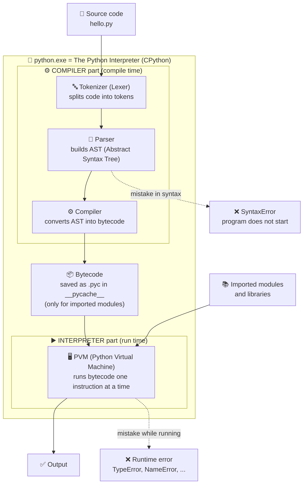

# Python Basics

## What is Python?

- Python is a high-level, general-purpose programming language.
- It is widely used in the IT industry because it is:

  - Easy to learn
  - Simple
  - Beginner-friendly

The official Python FAQ describes Python as an **interpreted, interactive, object-oriented** programming language that **also supports procedural and functional** programming.

| Term                      | Meaning in simple words                                                                                 |
| ------------------------- | ------------------------------------------------------------------------------------------------------- |
| **High-level**      | You write code close to human language. You don't manage memory, CPU registers, or pointers yourself.   |
| **General-purpose** | Not made for one job. You can build websites, AI apps, scripts, games, data analysis, etc.              |
| **Interpreted**     | You don't create a `.exe` before running. You run `python file.py` and Python executes it directly. |
| **Interactive**     | You can type code in the Python shell (REPL) and see the result immediately.                            |
| **Object-oriented** | Supports classes and objects. In Python, *everything* is an object.                                   |
| **Multi-paradigm**  | You can write code in procedural, object-oriented, or functional style.                                 |

### Same task in 3 styles (multi-paradigm)

```python
nums = [1, 2, 3, 4, 5]

# 1. Procedural style
total = 0
for n in nums:
    total += n
print(total)            # 15

# 2. Functional style
print(sum(nums))        # 15

# 3. Object-oriented style
class Calculator:
    def add_all(self, values):
        return sum(values)

print(Calculator().add_all(nums))   # 15
```

### Where is Python used?

- **Web backend** → Django, Flask, FastAPI
- **AI / ML / GenAI** → PyTorch, TensorFlow, scikit-learn, LangChain, LangGraph
- **Data analysis** → NumPy, Pandas, Matplotlib
- **Automation & scripting** → file handling, scheduled jobs, web scraping
- **DevOps & cloud** → AWS SDK (boto3), Ansible
- **Testing** → pytest, Selenium

---

## Why is Python so popular?

### Reason 1: Simple, readable syntax

- Python is popular because its syntax closely resembles the English language.
- It uses **indentation (spaces)** instead of `{ }` to make blocks, so code always looks clean.

  ```python
  print("Hello World")
  ```
- In many other programming languages, multiple lines of code are often required to produce a single line of output. However, in Python, only one line of code is needed.

**Java — Hello World needs a class and a main method:**

```java
public class Main {
    public static void main(String[] args) {
        System.out.println("Hello World");
    }
}
```

**Another example — swap two variables:**

```python
a, b = 10, 20
a, b = b, a        # no temp variable needed
print(a, b)        # 20 10
```

### Reason 2: "Batteries included" — big standard library

Python comes with many ready-made modules, so you don't need to install anything for common tasks.

```python
import math, json

print(math.sqrt(16))                              # 4.0
print(json.dumps({"name": "Ganesh", "age": 25}))  # {"name": "Ganesh", "age": 25}
```

### Reason 3: Huge collection of third-party libraries

**PyPI** (Python Package Index) has hundreds of thousands of packages. Install any with `pip install <name>`.

### Reason 4: Number 1 language for AI / ML / Data

Almost all major AI tools have Python as their main language. This is the biggest reason for its growth in recent years.

### Reason 5: Fast to write → faster development

Less code = fewer bugs = faster delivery. Companies like this.

### ⚠️ Trade-off (important for interviews)

Python is **slower to run** than C, C++, or Java, because it is interpreted and dynamically typed.
That's why heavy libraries like NumPy are written in **C internally** — you get Python's simplicity with C's speed.

---

## History of Python

- Python was developed by **Guido van Rossum**, a Dutch programmer, at **CWI** (a research institute in the Netherlands).
- Development began in **December 1989**, during the Christmas holidays, as a hobby project.
- Python was first released in **February 1991** (version 0.9.0).
- It was designed to be simple, readable, and powerful. Guido wanted a language like **ABC** (an easy teaching language) but **extensible**, which ABC was not.

### Why the name "Python"?

Not named after the snake 🐍. Guido was reading scripts of the BBC comedy show **"Monty Python's Flying Circus"** and wanted a name that was short, unique, and a little mysterious.

### Key milestones

| Date                       | Event                                                                                                         |
| -------------------------- | ------------------------------------------------------------------------------------------------------------- |
| Late 1980s                 | Idea of Python came up                                                                                        |
| **December 1989**    | Guido started writing Python                                                                                  |
| **February 1991**    | First public release, version **0.9.0** (already had classes, exceptions, functions, lists, dicts)      |
| **January 1994**     | Python **1.0** released                                                                                 |
| **16 October 2000**  | Python **2.0** released — list comprehensions, garbage collector for reference cycles, Unicode support |
| **3 December 2008**  | Python **3.0** released — **not backward compatible** with Python 2                              |
| **12 July 2018**     | Guido stepped down as "BDFL" (Benevolent Dictator For Life). Python is now led by a Steering Council.         |
| **1 January 2020**   | Python 2 reached **end of life** (final release 2.7.18 came in April 2020)                              |
| **Today (Nov 2026)** | Latest release is **Python 3.15.2** (Oct 25, 2026). A new 3.x version comes every October.              |

### Python has two major historical versions

- **Python 2** — **end-of-life since 1 January 2020**. No bug fixes or security fixes. Do not use it for new projects.
- **Python 3** — the current version. Always use this.

| Feature            | Python 2                     | Python 3                     |
| ------------------ | ---------------------------- | ---------------------------- |
| print              | `print "Hi"` (a statement) | `print("Hi")` (a function) |
| Division `5 / 2` | `2` (integer division)     | `2.5` (true division)      |
| Strings            | ASCII by default             | Unicode by default           |
| Input              | `raw_input()`              | `input()`                  |
| Support            | ❌ Dead since 2020           | ✅ Active                    |

```python
# Python 3
print(5 / 2)    # 2.5  -> true division
print(5 // 2)   # 2    -> floor division (use this if you want an integer)
```

---

## Features of Python

### 1. Simple and easy to learn

Few keywords, clean syntax, no semicolons, no `{ }`. Beginners can write useful programs in their first week.

### 2. Free and open source

- **Free:** no license cost, even for commercial use.
- **Open source:** the source code is public. Anyone can read it, improve it, or create their own version.
- Managed by the **Python Software Foundation (PSF)** under the PSF License.

### 3. High-level — Python manages memory automatically

You never allocate or free memory yourself (unlike `malloc` / `free` in C).
Python uses:

- **Reference counting** — each object counts how many variables point to it. When the count becomes 0, the memory is freed.
- **Garbage collector** — cleans objects that point to each other in a cycle (reference cycles).

### 4. Platform independent — WORA (Write Once, Run Anywhere)

How it works:

```
your_code.py  ──(compile)──>  bytecode (.pyc)  ──>  PVM (Python Virtual Machine)  ──>  output
```

- The same `.py` file runs on **Windows, Linux, and macOS** without changes.
- Condition: Python must be installed on that machine.
- Small note: OS-specific code (like file paths `C:\` vs `/home`) may need care. Use `pathlib` to stay safe.

### 5. Dynamically typed — data type specification is not required

Python decides the type **at runtime** based on the value.

```python
x = 10
print(type(x))   # <class 'int'>

x = "ten"        # same variable, now a string — allowed
print(type(x))   # <class 'str'>
```

**But Python is also *strongly* typed** — it will not mix types automatically:

```python
"5" + 5          # TypeError: can only concatenate str (not "int") to str

print("5" + str(5))   # 55   -> string joining
print(int("5") + 5)   # 10   -> number adding
```

> 💡 Interview line: *"Python is dynamically typed AND strongly typed."*

### 6. Object-oriented language

Supports classes, objects, inheritance, polymorphism, and encapsulation.
In Python **everything is an object** — even numbers and functions:

```python
print(type(5))             # <class 'int'>
print((5).bit_length())    # 3        -> even a number has methods
print("hello".upper())     # HELLO

def greet(): pass
print(type(greet))         # <class 'function'>
```

### 7. Interpreted language

- No separate compile step done by you. Just run `python file.py`.
- Internally, Python first converts code to **bytecode**, then the **PVM** runs it.
- Benefit: easy to test and debug — errors show the exact line number.

You can see the bytecode yourself:

```python
import dis

def add(a, b):
    return a + b

dis.dis(add)    # shows instructions like LOAD_FAST, BINARY_ADD/BINARY_OP, RETURN_VALUE
                # (exact names change between Python versions)
```

### 8. Large standard library ("batteries included")

Ready-made modules: `os`, `sys`, `math`, `datetime`, `json`, `csv`, `re`, `random`, `pathlib`, `logging`, `unittest`, `asyncio` and many more.

### 9. Extensible and embeddable

- **Extensible:** you can write slow parts in **C/C++** and call them from Python (NumPy, Pandas do this).
- **Embeddable:** you can put Python inside a C/C++ application as a scripting language.

### 10. Huge community and third-party libraries

Millions of developers, lots of tutorials, and almost every problem already has an answer on Stack Overflow. Libraries are installed from PyPI with `pip`.

### 11. Multi-paradigm

Procedural + Object-oriented + Functional (see the example in "What is Python?").

### 12. Interactive mode (REPL)

Type `python` in the terminal and test code line by line:

```
>>> 2 + 3
5
>>> "abc".upper()
'ABC'
```

---

## How Python Code Runs (Execution Flow)

When you type `python hello.py`, Python does **not** run your text directly. It goes through these steps inside **CPython** (the default Python you download from python.org):

### Execution flow diagram


### Short version (easy to remember)
```
 .py file ──> Tokenizer ──> Parser (AST) ──> Compiler ──> Bytecode (.pyc) ──> PVM ──> Output
 └────────────── compile time ──────────────────────────────┘   └── run time ──┘
```

### Each step explained
| Step | What happens | Who does it |
|---|---|---|
| **1. Source code** | You write `hello.py` in plain text. | You |
| **2. Tokenizer** | Breaks the text into small pieces called **tokens**: names, numbers, operators. | Python, automatically |
| **3. Parser** | Checks the grammar and builds a tree called the **AST**. A `SyntaxError` is raised here, so the program does not start at all. | Python, automatically |
| **4. Compiler** | Turns the AST into **bytecode**: simple low-level instructions for the PVM. Not machine code. | Python, automatically |
| **5. .pyc file** | Bytecode of **imported** modules is saved in the `__pycache__` folder, so the next run is faster (Python skips steps 2–4 if the file did not change). | Python, automatically |
| **6. PVM** | The Python Virtual Machine reads bytecode instructions one by one and executes them. Runtime errors (`TypeError`, `NameError`, `ZeroDivisionError`) happen here. | Python, automatically |
| **7. Output** | You see the result. | — |

### Where are the Compiler and the Interpreter?
When people say **"the Python interpreter"**, they mean the whole program `python.exe` (CPython). That **one program has two parts inside it**:

```
                  python.exe  =  "The Python Interpreter" (CPython)
┌────────────────────────────────────────────────────────────────────────────┐
│                                                                            │
│   ┌──────────── COMPILER part ─────────────┐   ┌──── INTERPRETER part ───┐ │
│   │                                         │   │                         │ │
│   │  Tokenizer ──> Parser ──> Compiler ─────┼──>│  PVM runs the bytecode  │ │
│   │                (AST)      (bytecode)    │   │  instruction by         │ │
│   │                                         │   │  instruction            │ │
│   └─────────────────────────────────────────┘   └─────────────────────────┘ │
│                                                                            │
└────────────────────────────────────────────────────────────────────────────┘
   hello.py goes in ───────────────────────────────────────────> output comes out
```

- **Compiler part** = Tokenizer + Parser + Compiler. It converts `.py` code into **bytecode**. It does **not** make machine code like a C compiler does.
- **Interpreter part** = the **PVM**. It reads the bytecode one instruction at a time and runs it. This is why Python is called an "interpreted language".

### Python vs C vs Java
| Language | Compile step | Run step |
|---|---|---|
| **C / C++** | Compiler → **machine code** (`.exe`), done before running | CPU runs it directly |
| **Java** | `javac` → bytecode (`.class`), a step **you** run | JVM runs it |
| **Python** | → bytecode (`.pyc`), done **automatically** inside `python.exe` | PVM runs it |

Python and Java work the same way: **compile to bytecode, then a virtual machine runs it**. The difference is that Python hides the compile step. You only type `python hello.py`, so it *feels* like Python only interprets.

> 💡 **Interview answer:** *"Python is both compiled and interpreted. CPython first compiles source code to bytecode, and then the PVM interprets that bytecode. We call it interpreted because the compile step is automatic and there is no separate build step."*

### See every step with your own eyes
```python
import tokenize, io, ast, dis

code = "x = 5 + 3\nprint(x)\n"

# Step 2: tokens
for tok in tokenize.generate_tokens(io.StringIO(code).readline):
    print(tokenize.tok_name[tok.type], repr(tok.string))
# NAME 'x'
# OP '='
# NUMBER '5'
# OP '+'
# NUMBER '3'
# ...

# Step 3: AST (tree)
print(ast.dump(ast.parse("x = 5 + 3"), indent=2))
# Module(
#   body=[
#     Assign(
#       targets=[Name(id='x', ctx=Store())],
#       value=BinOp(left=Constant(value=5), op=Add(), right=Constant(value=3)))],
#   ...)

# Step 4: compile to bytecode
bytecode = compile(code, "<demo>", "exec")
print(type(bytecode))    # <class 'code'>
dis.dis(bytecode)
#  1   LOAD_CONST   (8)      <- Python already calculated 5 + 3 = 8 at compile time!
#      STORE_NAME   (x)
#  2   LOAD_NAME    (print)
#      ...

# Step 6: PVM runs it
exec(bytecode)           # 8
```
> 💡 Notice: the bytecode says `LOAD_CONST 8`, not `5 + 3`. The compiler does small optimizations like this (called **constant folding**).
> Instruction names can be a little different in each Python version.

### Where is the .pyc file?
```
my_project/
├── main.py            <- you run this (its .pyc is NOT saved)
├── helper.py          <- imported by main.py
└── __pycache__/
    └── helper.cpython-310.pyc   <- bytecode of helper.py (310 = Python 3.10)
```
- The `__pycache__` folder is safe to delete. Python creates it again.
- That's why `__pycache__/` is in `.gitignore` — never push it to GitHub.

### Compile time vs run time errors
```python
# SyntaxError -> caught by the PARSER, nothing runs, not even line 1
print("start")
if True print("hi")      # SyntaxError: invalid syntax

# Runtime error -> caught by the PVM, lines before it DO run
print("start")           # start  (this prints)
print(10 / 0)            # ZeroDivisionError: division by zero
```

### Other Python implementations
| Implementation | How it runs code |
|---|---|
| **CPython** | Default. Written in C. Bytecode + PVM (the flow above). |
| **PyPy** | Uses a **JIT compiler**, which turns hot code into machine code. Often much faster for long-running programs. |
| **Jython** | Runs Python on the Java Virtual Machine (JVM). |
| **IronPython** | Runs Python on .NET. |

### 🎯 Interview questions on execution flow
**Q. What happens when you run a Python program?**
Source code → tokenizer → parser (AST) → compiler → bytecode → PVM executes it → output.

**Q. What is a .pyc file?**
A file that stores compiled bytecode of an imported module, kept in `__pycache__`. It makes the next import faster. It is not machine code and it is specific to the Python version.

**Q. Is bytecode the same as machine code?**
No. Machine code runs directly on the CPU. Bytecode runs on the PVM, which is why it works on any OS.

**Q. When do you get a SyntaxError vs a runtime error?**
SyntaxError comes at compile time (parser), so the program never starts. Runtime errors come while the PVM is running the code, so earlier lines already ran.

---

## 🎯 Interview Questions

**Q1. Is Python compiled or interpreted?**
Both, in a way. Python source code is first **compiled to bytecode** (`.pyc`), and then the bytecode is **interpreted by the PVM**. We call it an interpreted language because we don't do a separate compile step.

**Q2. What is the difference between dynamically typed and strongly typed?**

- *Dynamically typed:* type is checked at runtime, and a variable can hold any type.
- *Strongly typed:* Python does not convert types automatically (`"5" + 5` gives an error).

**Q3. What are the main differences between Python 2 and Python 3?**
`print` is a function, `/` does true division, strings are Unicode by default, `raw_input()` became `input()`. Python 2 is dead since 2020.

**Q4. What is the PVM?**
The Python Virtual Machine — the part of Python that runs the bytecode line by line. It is the reason the same code runs on any OS.

**Q5. Why is Python slower than C or Java?**
Because it is interpreted and dynamically typed: types are checked at runtime on every operation. Heavy work is moved to C-based libraries (NumPy) to get speed.

**Q6. Who created Python and why is it named Python?**
Guido van Rossum, started in December 1989 at CWI, Netherlands. Named after the comedy show *Monty Python's Flying Circus*.

**Q7. How is memory managed in Python?**
Automatically — by reference counting plus a garbage collector that removes reference cycles.

---

Execution Flow of Python Program
