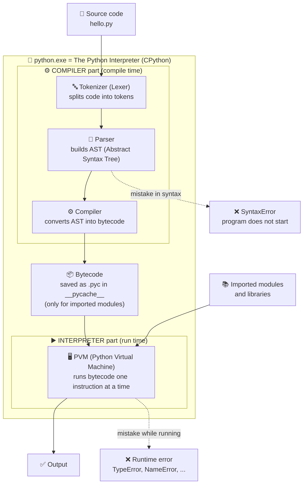

git add .
git commit -m "Notes: add Literals in Python section"
git push

# Python Basics

## What is Python?

- Python is a high-level, general-purpose programming language.
- It is widely used in the IT industry because it is:

  - Easy to learn
  - Simple
  - Beginner-friendly

The official Python FAQ describes Python as an **interpreted, interactive, object-oriented** programming language that **also supports procedural and functional** programming.

| Term                      | Meaning in simple words                                                                                 |
| ------------------------- | ------------------------------------------------------------------------------------------------------- |
| **High-level**      | You write code close to human language. You don't manage memory, CPU registers, or pointers yourself.   |
| **General-purpose** | Not made for one job. You can build websites, AI apps, scripts, games, data analysis, etc.              |
| **Interpreted**     | You don't create a `.exe` before running. You run `python file.py` and Python executes it directly. |
| **Interactive**     | You can type code in the Python shell (REPL) and see the result immediately.                            |
| **Object-oriented** | Supports classes and objects. In Python, *everything* is an object.                                   |
| **Multi-paradigm**  | You can write code in procedural, object-oriented, or functional style.                                 |

### Same task in 3 styles (multi-paradigm)

```python
nums = [1, 2, 3, 4, 5]

# 1. Procedural style
total = 0
for n in nums:
    total += n
print(total)            # 15

# 2. Functional style
print(sum(nums))        # 15

# 3. Object-oriented style
class Calculator:
    def add_all(self, values):
        return sum(values)

print(Calculator().add_all(nums))   # 15
```

### Where is Python used?

- **Web backend** → Django, Flask, FastAPI
- **AI / ML / GenAI** → PyTorch, TensorFlow, scikit-learn, LangChain, LangGraph
- **Data analysis** → NumPy, Pandas, Matplotlib
- **Automation & scripting** → file handling, scheduled jobs, web scraping
- **DevOps & cloud** → AWS SDK (boto3), Ansible
- **Testing** → pytest, Selenium

---

## Why is Python so popular?

### Reason 1: Simple, readable syntax

- Python is popular because its syntax closely resembles the English language.
- It uses **indentation (spaces)** instead of `{ }` to make blocks, so code always looks clean.

  ```python
  print("Hello World")
  ```
- In many other programming languages, multiple lines of code are often required to produce a single line of output. However, in Python, only one line of code is needed.

**Java — Hello World needs a class and a main method:**

```java
public class Main {
    public static void main(String[] args) {
        System.out.println("Hello World");
    }
}
```

**Another example — swap two variables:**

```python
a, b = 10, 20
a, b = b, a        # no temp variable needed
print(a, b)        # 20 10
```

### Reason 2: "Batteries included" — big standard library

Python comes with many ready-made modules, so you don't need to install anything for common tasks.

```python
import math, json

print(math.sqrt(16))                              # 4.0
print(json.dumps({"name": "Ganesh", "age": 25}))  # {"name": "Ganesh", "age": 25}
```

### Reason 3: Huge collection of third-party libraries

**PyPI** (Python Package Index) has hundreds of thousands of packages. Install any with `pip install <name>`.

### Reason 4: Number 1 language for AI / ML / Data

Almost all major AI tools have Python as their main language. This is the biggest reason for its growth in recent years.

### Reason 5: Fast to write → faster development

Less code = fewer bugs = faster delivery. Companies like this.

### ⚠️ Trade-off (important for interviews)

Python is **slower to run** than C, C++, or Java, because it is interpreted and dynamically typed.
That's why heavy libraries like NumPy are written in **C internally** — you get Python's simplicity with C's speed.

---

## History of Python

- Python was developed by **Guido van Rossum**, a Dutch programmer, at **CWI** (a research institute in the Netherlands).
- Development began in **December 1989**, during the Christmas holidays, as a hobby project.
- Python was first released in **February 1991** (version 0.9.0).
- It was designed to be simple, readable, and powerful. Guido wanted a language like **ABC** (an easy teaching language) but **extensible**, which ABC was not.

### Why the name "Python"?

Not named after the snake 🐍. Guido was reading scripts of the BBC comedy show **"Monty Python's Flying Circus"** and wanted a name that was short, unique, and a little mysterious.

### Key milestones

| Date                       | Event                                                                                                         |
| -------------------------- | ------------------------------------------------------------------------------------------------------------- |
| Late 1980s                 | Idea of Python came up                                                                                        |
| **December 1989**    | Guido started writing Python                                                                                  |
| **February 1991**    | First public release, version **0.9.0** (already had classes, exceptions, functions, lists, dicts)      |
| **January 1994**     | Python **1.0** released                                                                                 |
| **16 October 2000**  | Python **2.0** released — list comprehensions, garbage collector for reference cycles, Unicode support |
| **3 December 2008**  | Python **3.0** released — **not backward compatible** with Python 2                              |
| **12 July 2018**     | Guido stepped down as "BDFL" (Benevolent Dictator For Life). Python is now led by a Steering Council.         |
| **1 January 2020**   | Python 2 reached **end of life** (final release 2.7.18 came in April 2020)                              |
| **Today (Nov 2026)** | Latest release is **Python 3.15.2** (Oct 25, 2026). A new 3.x version comes every October.              |

### Python has two major historical versions

- **Python 2** — **end-of-life since 1 January 2020**. No bug fixes or security fixes. Do not use it for new projects.
- **Python 3** — the current version. Always use this.

| Feature            | Python 2                     | Python 3                     |
| ------------------ | ---------------------------- | ---------------------------- |
| print              | `print "Hi"` (a statement) | `print("Hi")` (a function) |
| Division `5 / 2` | `2` (integer division)     | `2.5` (true division)      |
| Strings            | ASCII by default             | Unicode by default           |
| Input              | `raw_input()`              | `input()`                  |
| Support            | ❌ Dead since 2020           | ✅ Active                    |

```python
# Python 3
print(5 / 2)    # 2.5  -> true division
print(5 // 2)   # 2    -> floor division (use this if you want an integer)
```

---

## Features of Python

### 1. Simple and easy to learn

Few keywords, clean syntax, no semicolons, no `{ }`. Beginners can write useful programs in their first week.

### 2. Free and open source

- **Free:** no license cost, even for commercial use.
- **Open source:** the source code is public. Anyone can read it, improve it, or create their own version.
- Managed by the **Python Software Foundation (PSF)** under the PSF License.

### 3. High-level — Python manages memory automatically

You never allocate or free memory yourself (unlike `malloc` / `free` in C).
Python uses:

- **Reference counting** — each object counts how many variables point to it. When the count becomes 0, the memory is freed.
- **Garbage collector** — cleans objects that point to each other in a cycle (reference cycles).

### 4. Platform independent — WORA (Write Once, Run Anywhere)

How it works:

```
your_code.py  ──(compile)──>  bytecode (.pyc)  ──>  PVM (Python Virtual Machine)  ──>  output
```

- The same `.py` file runs on **Windows, Linux, and macOS** without changes.
- Condition: Python must be installed on that machine.
- Small note: OS-specific code (like file paths `C:\` vs `/home`) may need care. Use `pathlib` to stay safe.

### 5. Dynamically typed — data type specification is not required

Python decides the type **at runtime** based on the value.

```python
x = 10
print(type(x))   # <class 'int'>

x = "ten"        # same variable, now a string — allowed
print(type(x))   # <class 'str'>
```

**But Python is also *strongly* typed** — it will not mix types automatically:

```python
"5" + 5          # TypeError: can only concatenate str (not "int") to str

print("5" + str(5))   # 55   -> string joining
print(int("5") + 5)   # 10   -> number adding
```

> 💡 Interview line: *"Python is dynamically typed AND strongly typed."*

### 6. Object-oriented language

Supports classes, objects, inheritance, polymorphism, and encapsulation.
In Python **everything is an object** — even numbers and functions:

```python
print(type(5))             # <class 'int'>
print((5).bit_length())    # 3        -> even a number has methods
print("hello".upper())     # HELLO

def greet(): pass
print(type(greet))         # <class 'function'>
```

### 7. Interpreted language

- No separate compile step done by you. Just run `python file.py`.
- Internally, Python first converts code to **bytecode**, then the **PVM** runs it.
- Benefit: easy to test and debug — errors show the exact line number.

You can see the bytecode yourself:

```python
import dis

def add(a, b):
    return a + b

dis.dis(add)    # shows instructions like LOAD_FAST, BINARY_ADD/BINARY_OP, RETURN_VALUE
                # (exact names change between Python versions)
```

### 8. Large standard library ("batteries included")

Ready-made modules: `os`, `sys`, `math`, `datetime`, `json`, `csv`, `re`, `random`, `pathlib`, `logging`, `unittest`, `asyncio` and many more.

### 9. Extensible and embeddable

- **Extensible:** you can write slow parts in **C/C++** and call them from Python (NumPy, Pandas do this).
- **Embeddable:** you can put Python inside a C/C++ application as a scripting language.

### 10. Huge community and third-party libraries

Millions of developers, lots of tutorials, and almost every problem already has an answer on Stack Overflow. Libraries are installed from PyPI with `pip`.

### 11. Multi-paradigm

Procedural + Object-oriented + Functional (see the example in "What is Python?").

### 12. Interactive mode (REPL)

Type `python` in the terminal and test code line by line:

```
>>> 2 + 3
5
>>> "abc".upper()
'ABC'
```

---

## How Python Code Runs (Execution Flow)

When you type `python hello.py`, Python does **not** run your text directly. It goes through these steps inside **CPython** (the default Python you download from python.org):

### Execution flow diagram



### Short version (easy to remember)

```
 .py file ──> Tokenizer ──> Parser (AST) ──> Compiler ──> Bytecode (.pyc) ──> PVM ──> Output
 └────────────── compile time ──────────────────────────────┘   └── run time ──┘
```

### Each step explained

| Step                     | What happens                                                                                                                                                           | Who does it           |
| ------------------------ | ---------------------------------------------------------------------------------------------------------------------------------------------------------------------- | --------------------- |
| **1. Source code** | You write `hello.py` in plain text.                                                                                                                                  | You                   |
| **2. Tokenizer**   | Breaks the text into small pieces called **tokens**: names, numbers, operators.                                                                                  | Python, automatically |
| **3. Parser**      | Checks the grammar and builds a tree called the **AST**. A `SyntaxError` is raised here, so the program does not start at all.                                 | Python, automatically |
| **4. Compiler**    | Turns the AST into **bytecode**: simple low-level instructions for the PVM. Not machine code.                                                                    | Python, automatically |
| **5. .pyc file**   | Bytecode of **imported** modules is saved in the `__pycache__` folder, so the next run is faster (Python skips steps 2–4 if the file did not change).         | Python, automatically |
| **6. PVM**         | The Python Virtual Machine reads bytecode instructions one by one and executes them. Runtime errors (`TypeError`, `NameError`, `ZeroDivisionError`) happen here. | Python, automatically |
| **7. Output**      | You see the result.                                                                                                                                                    | —                    |

### Where are the Compiler and the Interpreter?

When people say **"the Python interpreter"**, they mean the whole program `python.exe` (CPython). That **one program has two parts inside it**:

```
                  python.exe  =  "The Python Interpreter" (CPython)
┌────────────────────────────────────────────────────────────────────────────┐
│                                                                            │
│   ┌──────────── COMPILER part ─────────────┐   ┌──── INTERPRETER part ───┐ │
│   │                                         │   │                         │ │
│   │  Tokenizer ──> Parser ──> Compiler ─────┼──>│  PVM runs the bytecode  │ │
│   │                (AST)      (bytecode)    │   │  instruction by         │ │
│   │                                         │   │  instruction            │ │
│   └─────────────────────────────────────────┘   └─────────────────────────┘ │
│                                                                            │
└────────────────────────────────────────────────────────────────────────────┘
   hello.py goes in ───────────────────────────────────────────> output comes out
```

- **Compiler part** = Tokenizer + Parser + Compiler. It converts `.py` code into **bytecode**. It does **not** make machine code like a C compiler does.
- **Interpreter part** = the **PVM**. It reads the bytecode one instruction at a time and runs it. This is why Python is called an "interpreted language".

### Python vs C vs Java

| Language          | Compile step                                                               | Run step             |
| ----------------- | -------------------------------------------------------------------------- | -------------------- |
| **C / C++** | Compiler → **machine code** (`.exe`), done before running         | CPU runs it directly |
| **Java**    | `javac` → bytecode (`.class`), a step **you** run               | JVM runs it          |
| **Python**  | → bytecode (`.pyc`), done **automatically** inside `python.exe` | PVM runs it          |

Python and Java work the same way: **compile to bytecode, then a virtual machine runs it**. The difference is that Python hides the compile step. You only type `python hello.py`, so it *feels* like Python only interprets.

> 💡 **Interview answer:** *"Python is both compiled and interpreted. CPython first compiles source code to bytecode, and then the PVM interprets that bytecode. We call it interpreted because the compile step is automatic and there is no separate build step."*

### See every step with your own eyes

```python
import tokenize, io, ast, dis

code = "x = 5 + 3\nprint(x)\n"

# Step 2: tokens
for tok in tokenize.generate_tokens(io.StringIO(code).readline):
    print(tokenize.tok_name[tok.type], repr(tok.string))
# NAME 'x'
# OP '='
# NUMBER '5'
# OP '+'
# NUMBER '3'
# ...

# Step 3: AST (tree)
print(ast.dump(ast.parse("x = 5 + 3"), indent=2))
# Module(
#   body=[
#     Assign(
#       targets=[Name(id='x', ctx=Store())],
#       value=BinOp(left=Constant(value=5), op=Add(), right=Constant(value=3)))],
#   ...)

# Step 4: compile to bytecode
bytecode = compile(code, "<demo>", "exec")
print(type(bytecode))    # <class 'code'>
dis.dis(bytecode)
#  1   LOAD_CONST   (8)      <- Python already calculated 5 + 3 = 8 at compile time!
#      STORE_NAME   (x)
#  2   LOAD_NAME    (print)
#      ...

# Step 6: PVM runs it
exec(bytecode)           # 8
```

> 💡 Notice: the bytecode says `LOAD_CONST 8`, not `5 + 3`. The compiler does small optimizations like this (called **constant folding**).
> Instruction names can be a little different in each Python version.

### Where is the .pyc file?

```
my_project/
├── main.py            <- you run this (its .pyc is NOT saved)
├── helper.py          <- imported by main.py
└── __pycache__/
    └── helper.cpython-310.pyc   <- bytecode of helper.py (310 = Python 3.10)
```

- The `__pycache__` folder is safe to delete. Python creates it again.
- That's why `__pycache__/` is in `.gitignore` — never push it to GitHub.

### Compile time vs run time errors

```python
# SyntaxError -> caught by the PARSER, nothing runs, not even line 1
print("start")
if True print("hi")      # SyntaxError: invalid syntax

# Runtime error -> caught by the PVM, lines before it DO run
print("start")           # start  (this prints)
print(10 / 0)            # ZeroDivisionError: division by zero
```

### Other Python implementations

| Implementation       | How it runs code                                                                                                    |
| -------------------- | ------------------------------------------------------------------------------------------------------------------- |
| **CPython**    | Default. Written in C. Bytecode + PVM (the flow above).                                                             |
| **PyPy**       | Uses a **JIT compiler**, which turns hot code into machine code. Often much faster for long-running programs. |
| **Jython**     | Runs Python on the Java Virtual Machine (JVM).                                                                      |
| **IronPython** | Runs Python on .NET.                                                                                                |

### 🎯 Interview questions on execution flow

**Q. What happens when you run a Python program?**
Source code → tokenizer → parser (AST) → compiler → bytecode → PVM executes it → output.

**Q. What is a .pyc file?**
A file that stores compiled bytecode of an imported module, kept in `__pycache__`. It makes the next import faster. It is not machine code and it is specific to the Python version.

**Q. Is bytecode the same as machine code?**
No. Machine code runs directly on the CPU. Bytecode runs on the PVM, which is why it works on any OS.

**Q. When do you get a SyntaxError vs a runtime error?**
SyntaxError comes at compile time (parser), so the program never starts. Runtime errors come while the PVM is running the code, so earlier lines already ran.

---

## 🎯 Interview Questions

**Q1. Is Python compiled or interpreted?**
Both, in a way. Python source code is first **compiled to bytecode** (`.pyc`), and then the bytecode is **interpreted by the PVM**. We call it an interpreted language because we don't do a separate compile step.

**Q2. What is the difference between dynamically typed and strongly typed?**

- *Dynamically typed:* type is checked at runtime, and a variable can hold any type.
- *Strongly typed:* Python does not convert types automatically (`"5" + 5` gives an error).

**Q3. What are the main differences between Python 2 and Python 3?**
`print` is a function, `/` does true division, strings are Unicode by default, `raw_input()` became `input()`. Python 2 is dead since 2020.

**Q4. What is the PVM?**
The Python Virtual Machine — the part of Python that runs the bytecode line by line. It is the reason the same code runs on any OS.

**Q5. Why is Python slower than C or Java?**
Because it is interpreted and dynamically typed: types are checked at runtime on every operation. Heavy work is moved to C-based libraries (NumPy) to get speed.

**Q6. Who created Python and why is it named Python?**
Guido van Rossum, started in December 1989 at CWI, Netherlands. Named after the comedy show *Monty Python's Flying Circus*.

**Q7. How is memory managed in Python?**
Automatically — by reference counting plus a garbage collector that removes reference cycles.

## 🗣️ How to Explain These Topics in an Interview

Knowing the answer is not enough. **How you explain it** decides how the interviewer rates you. This section gives a simple formula, ready-to-speak answers, analogies, and mistakes to avoid.

### The 4-step formula for any concept question

Use this for every "What is X?" or "Explain X" question:

| Step                              | What to say                     | Example (dynamic typing)                                                           |
| --------------------------------- | ------------------------------- | ---------------------------------------------------------------------------------- |
| **1. Define**               | One clear sentence              | "Dynamic typing means the type is decided at runtime, not declared."               |
| **2. How it works**         | 1–2 sentences on the mechanism | "Python checks the type of the object when the line runs."                         |
| **3. Example**              | Small code or real-life example | "`x = 10` then `x = "ten"` — both are allowed."                               |
| **4. Trade-off / real use** | Why it matters, pros and cons   | "Faster to write, but bugs show up at runtime, so in production I add type hints." |

### Golden rules

1. **Start short (30 seconds), then stop.** Let the interviewer ask for more. A short, clear answer is better than a 5-minute speech.
2. **Don't recite a textbook definition.** Interviewers want to see that you *understand*, not that you memorized.
3. **Always mention a trade-off.** Interviewers say that a candidate who talks about *when* to use something and its limits, not only *what* it is, scores more points.
4. **Connect to your own work.** One line like "In my project I used…" makes your answer stand out from every other candidate.
5. **Say "in CPython"** when talking about internals. It shows you know Python has more than one implementation.
6. **Draw it.** If there is a whiteboard or a shared screen, draw the flow: `.py → bytecode → PVM`. A diagram explains faster than words.

---

### Q1. "What is Python?"

❌ **Weak answer:**

> "Python is a high-level programming language. It is easy to learn."
> *(True, but it sounds memorized and says nothing about you.)*

✅ **Strong answer — 30 seconds:**

> "Python is a high-level, general-purpose language. It's dynamically typed and has automatic memory management, so I can focus on the problem instead of low-level details. It's multi-paradigm, so I can write procedural, object-oriented or functional code. Its biggest strength is the ecosystem — for example, almost every AI and data tool, like LangChain, PyTorch and Pandas, is Python-first."

✅ **Add this if they want more (connect to your work):**

> "In my current project I use Python with FastAPI for the backend and LangChain for a RAG chatbot. Python let us go from idea to a working prototype very fast. The trade-off is that Python is slower than Java or C, but in our case most of the time is spent waiting for the LLM and the database, not running Python code, so speed was not the bottleneck."

---

### Q2. "Is Python compiled or interpreted?"

This is one of the most common Python interview questions. Most candidates give a half answer.

❌ **Weak answer:**

> "Python is interpreted. It runs line by line."
> *(Incomplete — it misses the bytecode step.)*

✅ **Strong answer — 30 seconds:**

> "It's both. In CPython, the source code is first compiled into bytecode, which is saved as `.pyc` files in `__pycache__` for imported modules. Then the Python Virtual Machine interprets that bytecode instruction by instruction. We call Python interpreted because the compile step is automatic — there's no separate build step like in C or Java."

🎨 **Analogy that interviewers like — translating a book:**

- **Compiler (C/C++):** a translator translates the **whole book** first and prints a new book. Reading the new book later is fast, but you wait for the full translation first.
- **Interpreter:** a **live translator** at a meeting (like at the United Nations) translates **sentence by sentence** while the speaker talks. You start immediately, but it's slower overall, and if there is a mistake, it stops right there.
- **Python does both:** first it quickly rewrites your book into **short notes** (bytecode), then a **reader** (the PVM) reads those notes aloud one by one.

🔁 **Likely follow-up questions — be ready:**

| Follow-up                     | Short answer                                                                                                                                                       |
| ----------------------------- | ------------------------------------------------------------------------------------------------------------------------------------------------------------------ |
| "What is a .pyc file?"        | Cached bytecode of an imported module, so Python can skip re-compiling next time.                                                                                  |
| "Is bytecode machine code?"   | No. Machine code runs on the CPU; bytecode runs on the PVM. That's why it is platform independent.                                                                 |
| "Then how is Java different?" | Very similar model — Java compiles to bytecode and the JVM runs it. The difference is Java's compile step is explicit (`javac`) and the JVM has a JIT compiler. |
| "Is there a faster Python?"   | Yes, **PyPy** uses a JIT compiler that turns frequently used code into machine code.                                                                         |

---

### Q3. "What happens when you run a Python program?"

✅ **Strong answer — walk through a tiny example:**

> "Let's take `x = 5 + 3`. First the **tokenizer** splits it into tokens — `x`, `=`, `5`, `+`, `3`. The **parser** checks the grammar and builds an AST — an assignment node with an addition inside it. If there's a syntax error, it fails here and nothing runs. Then the **compiler** turns the AST into bytecode. Interesting detail: it already calculates `5 + 3` and stores the constant `8` — that's called constant folding. Finally the **PVM** executes the bytecode and stores 8 in `x`."

💡 **Why this works:** the small example + the "interesting detail" shows real understanding, not memorization. You can prove it live with `import dis; dis.dis(compile("x = 5 + 3", "", "exec"))`.

---

### Q4. "Python is dynamically typed. What does that mean? Is it weakly typed?"

✅ **Strong answer:**

> "Dynamically typed means I don't declare types — the type belongs to the object, not the variable, and it's checked at runtime. So `x = 10` and later `x = "ten"` is fine. But Python is **strongly** typed: it won't silently convert types, so `"5" + 5` raises a `TypeError`. JavaScript is weakly typed — `"5" - 3` gives `2` there."

🎨 **Analogy — variables are name tags, not boxes:**
In C, a variable is like a **box** with a fixed size and type. In Python, a variable is a **name tag (label)** that you stick on an object. You can move the tag to a different object any time.

```python
a = [1, 2]
b = a           # b is a second name tag on the SAME list
b.append(3)
print(a)        # [1, 2, 3]  -> a also changed, because it's the same object
```

*(This "names, not boxes" idea is from Ned Batchelder's famous PyCon talk — great to mention.)*

🏭 **Production angle (makes you sound experienced):**

> "Because of dynamic typing, some bugs only appear at runtime. In production code I use **type hints** and check them with **mypy**, and **Pydantic** for validating data coming into the API."

```python
def add(a: int, b: int) -> int:
    return a + b

print(add("5", "5"))   # 55  -> type hints are NOT enforced at runtime!
                       # a tool like mypy would catch this before running
```

---

### Q5. "Python is slow. Why do companies still use it?"

This question checks whether you think like an engineer, not a fan.

✅ **Strong answer:**

> "Yes, pure Python is slower than C or Java because it's interpreted and dynamically typed. But companies use it for three reasons. First, **developer time is more expensive than CPU time** — Python lets teams build and change things fast. Second, the heavy work is done in **C under the hood** — NumPy, Pandas and PyTorch are written in C/C++, so we get near-C speed with Python syntax. Third, many apps are **I/O-bound** — like web APIs or LLM apps — where the program mostly waits for the network or database, so Python's speed isn't the bottleneck. When speed really matters, we profile first and then optimize the hot part, or use PyPy or a C extension."

---

### Q6. "Difference between Python 2 and Python 3?"

✅ **Strong answer:**

> "Python 2 reached end-of-life on 1 January 2020, so all new work is Python 3. The main differences: `print` became a function, `/` does true division (`5/2` is `2.5`), strings are Unicode by default, and `raw_input()` became `input()`. Python 3 was intentionally not backward compatible to fix design problems."

---

### ⚠️ Common mistakes to avoid

| Mistake                               | Why it hurts                        | Do this instead                                            |
| ------------------------------------- | ----------------------------------- | ---------------------------------------------------------- |
| "Python is interpreted, line by line" | Shows you don't know about bytecode | Say "compiled to bytecode, then interpreted by the PVM"    |
| Saying "Python has no compiler"       | It does — inside CPython           | Mention the compile step                                   |
| "Python is weakly typed"              | Wrong — it is strongly typed       | "Dynamically **and** strongly typed"                 |
| Long answer with no example           | Interviewer loses interest          | 30-second answer + one small example                       |
| Only listing features                 | Sounds memorized                    | Add a trade-off and your own experience                    |
| Saying "I don't know" and stopping    | Looks like giving up                | "I'm not 100% sure, but I think it works like… because…" |

---

## Keywords in Python

- Keywords are **reserved words** in Python. These words have special meaning in Python.
- We **cannot use keywords** as variable name, function name, or class name.
- There are a total of **35 keywords** in Python (plus 3 "soft keywords").
- We can get the list of keywords using:
  ```python
  import keyword
  print(keyword.kwlist)        # list of all 35 keywords
  print(len(keyword.kwlist))   # 35
  print(keyword.softkwlist)    # ['_', 'case', 'match']  -> soft keywords
  print(keyword.iskeyword("if"))      # True
  print(keyword.iskeyword("hello"))   # False
  ```

### The 35 keywords, grouped by purpose

| Group                           | Keywords                                                        | What they do                                                                  |
| ------------------------------- | --------------------------------------------------------------- | ----------------------------------------------------------------------------- |
| **Values**                | `True`, `False`, `None`                                   | Built-in constant values                                                      |
| **Logical operators**     | `and`, `or`, `not`                                        | Combine boolean expressions                                                   |
| **Membership / identity** | `in`, `is`                                                  | Check if an item is in a collection / if two names point to the same object   |
| **Conditional**           | `if`, `elif`, `else`                                      | Decision making                                                               |
| **Loops**                 | `for`, `while`, `break`, `continue`, `pass`           | Looping and loop control                                                      |
| **Functions**             | `def`, `return`, `lambda`, `yield`                      | Define and return from functions, create anonymous functions, make generators |
| **Classes / OOP**         | `class`                                                       | Define a class                                                                |
| **Exceptions**            | `try`, `except`, `finally`, `raise`, `assert`         | Handle errors                                                                 |
| **Modules / scope**       | `import`, `from`, `as`, `global`, `nonlocal`, `del` | Import code, manage scope, delete names                                       |
| **Context manager**       | `with`                                                        | Clean resource handling (files, DB connections)                               |
| **Async**                 | `async`, `await`                                            | Asynchronous programming                                                      |
| **Soft keywords**         | `match`, `case`, `_`                                      | Pattern matching (Python 3.10+). Can still be used as variable names.         |

### Important rules

1. **Case-sensitive** — `True` is a keyword, but `true` is not. `if` is a keyword, but `If` is not.
2. **Cannot be redefined** — `if = 10` → `SyntaxError`.
3. **Don't shadow built-ins either** — `list`, `dict`, `str`, `type`, `id` are **not** keywords (they are built-in functions), but overwriting them is a bad practice:
   ```python
   list = [1, 2, 3]   # works, but now you can't call list() — don't do this!
   ```

### Examples for the most important keywords

**1. Logical: `and`, `or`, `not`**

```python
print(True and False)   # False
print(True or False)    # True
print(not True)         # False
```

**2. Membership and identity: `in`, `is`**

```python
print("a" in "abc")     # True   -> membership
print(5 in [1, 2, 3])   # False

a = [1, 2]
b = a                   # b points to the SAME list
c = [1, 2]              # c is a different list with same values
print(a is b)           # True   -> same object
print(a is c)           # False  -> different objects
print(a == c)           # True   -> same value
```

> 💡 Remember: `is` checks **identity** (same object in memory), `==` checks **equality** (same value).

**3. `del` — delete a name**

```python
x = 10
del x
# print(x)  -> NameError: name 'x' is not defined
```

**4. `global` and `nonlocal`**

```python
counter = 0            # global variable

def inc():
    global counter     # without this, counter += 1 would give UnboundLocalError
    counter += 1

inc(); inc()
print(counter)         # 2

def outer():
    x = "outer"
    def inner():
        nonlocal x     # use the x of the enclosing function, not global
        x = "changed"
    inner()
    return x

print(outer())         # changed
```

**5. `pass`, `break`, `continue`**

```python
for i in range(5):
    if i == 2:
        continue       # skip this iteration
    if i == 4:
        break          # exit the loop
    print(i, end=" ")  # 0 1 3

def not_ready_yet():
    pass               # placeholder — do nothing, no error
```

**6. `assert` — a sanity check**

```python
def divide(a, b):
    assert b != 0, "b must not be zero"
    return a / b
# If the condition is False, AssertionError is raised.
# Use it for developer checks, not for user input validation.
```

**7. `with` — context manager (auto cleanup)**

```python
with open("file.txt", "w") as f:
    f.write("hello")
# File is closed automatically here — even if an error happened inside
```

**8. `lambda` — anonymous function**

```python
square = lambda x: x * x
print(square(5))                    # 25
print(sorted([3, 1, 2], key=lambda x: -x))   # [3, 2, 1]
```

**9. `yield` — makes a generator**

```python
def count_up_to(n):
    i = 1
    while i <= n:
        yield i        # returns a value AND pauses, keeps its state
        i += 1

print(list(count_up_to(3)))   # [1, 2, 3]
# yield is memory-efficient — it doesn't build the whole list in memory
```

**10. `try / except / else / finally`**

```python
try:
    x = 10 / 2
except ZeroDivisionError:
    print("zero")
else:
    print("ok, got", x)   # runs only if no exception
finally:
    print("always runs")  # runs no matter what
# Output:
# ok, got 5.0
# always runs
```

**11. `async` and `await` — asynchronous code**

```python
import asyncio

async def fetch():
    await asyncio.sleep(1)    # don't block, let other code run
    return "done"

asyncio.run(fetch())
```

**12. `match` / `case` — pattern matching (Python 3.10+)**

```python
def http_status(code):
    match code:
        case 200:
            return "OK"
        case 404:
            return "Not Found"
        case 500 | 502 | 503:
            return "Server Error"
        case _:                 # _ is the wildcard, matches anything
            return "Unknown"

print(http_status(404))   # Not Found
```

### Mistakes I need to avoid

- ❌ Using a keyword as a variable: `class = "A"` → SyntaxError.
- ❌ Overwriting built-ins (not keywords, but still bad): `list = [1,2]`, `type = "person"`, `id = 5`.
  - If you must, add an underscore: `class_`, `type_`, `list_`.
- ❌ Forgetting `global` inside a function when you want to **modify** a global variable.
- ❌ Confusing `is` with `==`:
  ```python
  a = 1000
  b = 1000
  print(a == b)   # True
  print(a is b)   # False (usually — depends on Python's internal caching)
  ```

---

## 🎯 Interview Questions on Keywords

**Q1. How many keywords does Python have?**
35 reserved keywords plus 3 soft keywords (`match`, `case`, `_`). You can check with `import keyword; print(len(keyword.kwlist))`. The number may change in future Python versions — `async` and `await`, for example, became keywords only in Python 3.7.

**Q2. What is the difference between `is` and `==`?**

- `==` compares **values** (same content).
- `is` compares **identity** (same object in memory).
- Use `is` only for `None`, `True`, `False`: `if x is None:` — not `if x == None:`.

**Q3. What is the difference between `break`, `continue`, and `pass`?**

- `break` → exits the loop completely.
- `continue` → skips the rest of this iteration, goes to the next one.
- `pass` → does nothing. Placeholder when syntax needs a statement but you have nothing to do yet.

**Q4. What is the purpose of `global` and `nonlocal`?**

- `global` → inside a function, use/modify a variable from the module (global) scope.
- `nonlocal` → inside a nested function, use/modify a variable from the enclosing (non-global) function's scope.
- Without them, assignment creates a new local variable.

**Q5. What is a soft keyword?**
A word that works as a keyword only in certain contexts. `match`, `case`, and `_` were added in Python 3.10 for pattern matching. They are soft keywords, so old code that uses `match` as a variable name still works.

**Q6. Can we use a keyword as a variable name?**
No, it gives a `SyntaxError`. If you really need a name like `class`, add an underscore: `class_`. This is a common convention when working with Django or SQLAlchemy models.

**Q7. What is the difference between `yield` and `return`?**

- `return` ends the function and gives back a single value.
- `yield` pauses the function, gives back a value, and keeps the state so it can resume next time. Functions with `yield` become **generators** — memory efficient for large data.

---

## 🗣️ How to Explain Keywords in an Interview

### ✅ Strong answer — "What are keywords in Python?" (30 seconds)

> "Keywords are reserved words that Python's parser recognizes as part of the language — things like `if`, `def`, `class`, `return`, `try`. There are 35 of them in current Python, plus 3 soft keywords for pattern matching. You can't use them as variable or function names — Python raises a `SyntaxError`. I check with `import keyword; keyword.iskeyword('x')`. One thing I'm careful about: common names like `list`, `dict`, and `id` aren't keywords, they're built-in functions — so Python *lets* you overwrite them, but it breaks the built-in. For those I add an underscore, like `list_`."

### 🎨 Analogy that works well

> "Think of keywords as the **grammar words** of Python — like 'if', 'and', 'while' in English. You can name your dog anything, but you can't name it 'and' and then write a sentence. Similarly, you can name a variable almost anything, except the 35 words Python reserves for its grammar."

### 🔁 Likely follow-ups — be ready

| Follow-up                                             | Short answer                                                                                                                                                                                                      |
| ----------------------------------------------------- | ----------------------------------------------------------------------------------------------------------------------------------------------------------------------------------------------------------------- |
| "Difference between keywords and built-in functions?" | Keywords are part of the grammar (`if`, `def`) — you can't redefine them. Built-ins (`print`, `len`, `list`) are regular functions that Python provides — you *can* overwrite them (but shouldn't). |
| "Can the list of keywords change between versions?"   | Yes. `async` and `await` became keywords in Python 3.7. `match` / `case` were added as soft keywords in Python 3.10.                                                                                      |
| "Why are `True`, `False`, `None` keywords?"     | To stop anyone from reassigning them. In Python 2, `True = False` was legal and broke everything. Python 3 made them keywords.                                                                                  |
| "Is `self` a keyword?"                              | **No** — it's just a convention. You could write `def __init__(me, x):` and use `me` everywhere. But every Python developer expects `self`, so always use it.                                        |

### 🏭 Connect it to real work (makes you stand out)

> "In my FastAPI project, I had a database field called `class` for a telecom alarm category. Because `class` is a keyword, I couldn't use it as a Python attribute. I used `class_` in the SQLAlchemy model and mapped it back to `class` in the JSON response with Pydantic's `alias` field. That's a very common real-world case where knowing keywords matters."

### ⚠️ Mistakes to avoid in your answer

| Mistake                                               | Fix                                                                                                  |
| ----------------------------------------------------- | ---------------------------------------------------------------------------------------------------- |
| Saying "there are 33 keywords"                        | Check the current count with `len(keyword.kwlist)` — it's 35 now, and it changes between versions |
| Mixing up keywords and built-ins                      | Keywords = grammar; built-ins = functions Python provides                                            |
| Saying "`self` is a keyword"                        | It's just a convention, not a keyword                                                                |
| Using `is` instead of `==` for numbers or strings | Only use `is` for `None`, `True`, `False`                                                    |

---

## Literals in Python

- A **literal** is a **fixed value** written directly in the source code.
- Example: in `x = 10`, the `10` is a literal. In `name = "Ganesh"`, `"Ganesh"` is a literal.
- A literal is the **raw data itself**, not a name that points to data.
- Python has **6 main types** of literals:
  1. Numeric literals
  2. String literals
  3. Boolean literals
  4. Special literal (`None`)
  5. Collection literals (list, tuple, set, dict)
  6. Literal Collections (same as above — just another name people use)

### Literal vs variable — the simple difference

```python
x = 10          # x is a variable, 10 is the literal
y = "hello"     # y is a variable, "hello" is the literal
```

### 1. Numeric literals

Numbers written directly in the code. Python has 3 numeric types:

| Type              | Example                       | Notes                                  |
| ----------------- | ----------------------------- | -------------------------------------- |
| **int**     | `10`, `-5`, `0`         | Whole numbers                          |
| **float**   | `1.5`, `-3.14`, `1.5e3` | Decimal numbers; `e3` means ×10³   |
| **complex** | `2 + 3j`, `5j`            | Real + imaginary part (`j` is √−1) |

**Different number bases (useful for low-level work):**

```python
print(0b1010)    # 10   -> Binary (prefix 0b)
print(0o17)      # 15   -> Octal (prefix 0o)
print(0xff)      # 255  -> Hexadecimal (prefix 0x)
print(1_000_000) # 1000000  -> underscore for readability (Python 3.6+)
print(1.5e3)     # 1500.0   -> scientific notation
print(2 + 3j)    # (2+3j)   -> complex number
```

### 2. String literals

Text in quotes. Python is flexible about quotes:

```python
a = "hello"           # double quotes
b = 'hi'              # single quotes
c = """multi
line string"""        # triple quotes -> multi-line
d = '''also multi'''
```

**Special string types (prefixes):**

```python
r"C:\new\test"        # raw string -> backslash kept as-is
b"bytes"              # bytes literal
f"Hi {name}"          # f-string -> variable goes inside {}
u"unicode"            # Unicode (default in Python 3, prefix is optional)
```

> 💡 Without `r`, `"\n"` becomes a newline. With `r`, it stays `\n`. Useful for Windows paths and regex.

**Character literal** — Python has no separate `char` type. A single character is just a string of length 1:

```python
c = 'A'
print(len(c), type(c))   # 1 <class 'str'>
```

### 3. Boolean literals

Only two values: `True` and `False`. **Capital T and F** — `true` is not a keyword.

```python
is_active = True
is_done = False
print(True + True)   # 2   -> True is 1, False is 0 internally
print(True + 5)      # 6
```

### 4. Special literal: `None`

Represents "no value" or "nothing". Python's version of `null` / `nil`.

```python
result = None
if result is None:            # always use `is None`, not `== None`
    print("no result yet")
```

> 💡 `None`, `True`, `False` are the only three **keyword literals** — they are both keywords and literal values.

### 5. Collection literals

A way to create a collection directly, without calling its constructor:

| Type                                 | Literal              | Constructor        |
| ------------------------------------ | -------------------- | ------------------ |
| **list** (mutable, ordered)    | `[1, 2, 3]`        | `list([1,2,3])`  |
| **tuple** (immutable, ordered) | `(1, 2, 3)`        | `tuple([1,2,3])` |
| **set** (unique, no order)     | `{1, 2, 3}`        | `set([1,2,3])`   |
| **dict** (key-value)           | `{"a": 1, "b": 2}` | `dict(a=1, b=2)` |

```python
nums  = [1, 2, 3]
point = (4, 5)
tags  = {"python", "ai"}
user  = {"name": "Ganesh", "age": 24}

print(type(nums), type(point), type(tags), type(user))
# <class 'list'> <class 'tuple'> <class 'set'> <class 'dict'>
```

**Watch out — empty `{}` is a dict, not a set:**

```python
a = {}        # empty dict!
b = set()     # empty set
print(type(a), type(b))   # <class 'dict'> <class 'set'>
```

### 6. Other literals you'll see

- **Ellipsis literal:** `...` — used as a placeholder, especially with type hints and NumPy.
  ```python
  def not_ready(): ...     # same as 'pass' — valid function body
  print(type(...))         # <class 'ellipsis'>
  ```

### Mistakes I need to avoid

- ❌ `true` / `false` / `none` — lowercase won't work. Python is case-sensitive.
- ❌ `{}` meaning empty set — it's a dict. Use `set()`.
- ❌ Writing numbers with commas: `1,000,000` is actually a tuple. Use `1_000_000`.
- ❌ Forgetting `r"..."` for Windows paths → `"C:\new"` has a `\n` (newline).
- ❌ Comparing with `== None` instead of `is None`.

---

## 🎯 Interview Questions on Literals

**Q1. What is a literal in Python?**
A literal is a fixed value written directly in the source code. For example, in `age = 25`, `25` is the integer literal and `age` is the variable. Python has numeric, string, boolean, `None`, and collection literals.

**Q2. What are the different types of literals?**
Numeric (`int`, `float`, `complex`), String (normal, raw `r""`, bytes `b""`, f-string `f""`), Boolean (`True`, `False`), the special `None`, and collection literals for list, tuple, set, dict.

**Q3. Difference between a literal and a variable?**
A literal is the **actual value**; a variable is a **name** that points to a value. In `x = 10`, `10` is the literal, `x` is the variable.

**Q4. What is the difference between `{}` and `set()`?**
`{}` creates an **empty dict**, not an empty set. To make an empty set you must use `set()`. The `{}` set syntax only works when you put values inside, like `{1, 2, 3}`.

**Q5. What is a raw string literal?**
A string prefixed with `r`, where backslashes are not treated as escape characters. `print("a\nb")` prints two lines; `print(r"a\nb")` prints `a\nb` literally. Useful for Windows paths and regular expressions.

**Q6. What is an f-string?**
An f-string (formatted string literal, added in Python 3.6) lets you put expressions directly inside a string with `{}`:

```python
name, age = "Ganesh", 24
print(f"{name} is {age} years old")   # Ganesh is 24 years old
print(f"{2 + 3 = }")                  # 2 + 3 = 5   (Python 3.8+)
```

**Q7. Is `True + True` valid in Python?**
Yes — it gives `2`, because `bool` is a subclass of `int`. `True` is `1` and `False` is `0` internally.

---

## 🗣️ How to Explain Literals in an Interview

### ✅ Strong answer — "What are literals in Python?" (30 seconds)

> "A literal is a fixed value written directly in the source code — like `10`, `"hello"`, `True`, or `[1, 2, 3]`. In the statement `x = 10`, `10` is the literal and `x` is the variable pointing to it. Python has numeric literals (int, float, complex), string literals (including raw, bytes, and f-strings), boolean literals (`True`/`False`), the special `None`, and collection literals for list, tuple, set, and dict."

### 🎨 Analogy

> "Think of literals as the **actual ingredients** written on a recipe, and variables as the **labeled jars** where you store them. `sugar = 100` means '100' is the actual ingredient (literal), and 'sugar' is the jar's label (variable)."

### 🔁 Likely follow-ups — be ready

| Follow-up                                                    | Short answer                                                                                                                                                                                                    |
| ------------------------------------------------------------ | --------------------------------------------------------------------------------------------------------------------------------------------------------------------------------------------------------------- |
| "Why would you use a raw string?"                            | For Windows paths (`r"C:\Users\x"`) and regex patterns, so I don't have to double every backslash.                                                                                                            |
| "When would you use an f-string?"                            | For almost all string formatting in modern Python — it's fast, readable, and lets me put expressions inside directly.                                                                                          |
| "What's the difference between `None` and `0` / `""`?" | `None` means "no value at all". `0` and `""` are real values that just happen to be falsy. A function that returns `None` means "nothing to return"; one that returns `0` means "the answer is zero". |
| "Is `[1, 2, 3]` a literal?"                                | Yes — it's a **list literal** (sometimes called a "displayed literal" or "collection literal"). The language reference calls these "list displays".                                                      |

### 🏭 Connect it to real work

> "In my FastAPI project I use f-strings everywhere for log messages like `logger.info(f"User {user_id} fetched doc {doc_id}")` — it's much faster and more readable than `.format()` or `%` formatting. For regex in the broadband fault classifier I always use raw strings like `r"\d+Mbps"`, otherwise I'd need to double every backslash. And for optional fields in Pydantic models I use `None` as the default, with type hints like `Optional[str] = None`."

### ⚠️ Mistakes to avoid in your answer

| Mistake                            | Fix                                                                    |
| ---------------------------------- | ---------------------------------------------------------------------- |
| Mixing up literal and variable     | The literal is the **value**; the variable is the **name** |
| Saying `{}` creates an empty set | `{}` is an empty dict — use `set()` for an empty set              |
| Saying Python has a `char` type  | It doesn't — a single character is just a string of length 1          |
| Using `== None`                  | Always `is None` — PEP 8 says so, and it's faster                   |
---

## Variables in Python

- A **variable** is a **name that points to a value** stored in memory.
- Think of it as a **label** on an object, not a box containing the value.
- Python is **dynamically typed** — you don't declare the type. Python figures it out from the value.
- Variables are created the moment you first assign a value to them.

```python
x = 10           # creates a variable 'x' pointing to the integer 10
name = "Ganesh"  # creates 'name' pointing to the string "Ganesh"
```

### How variables work internally
In Python, a variable is a **name tag**, and the actual value is an **object** in memory.
```python
x = 10
# Step 1: Python creates an integer object 10 in memory
# Step 2: Python attaches the name 'x' to that object

print(x)           # 10
print(id(x))       # 140234567890  -> memory address of the object
print(type(x))     # <class 'int'>  -> what type the object is
```

> 💡 In C, a variable is a **box** with a fixed size and type. In Python, a variable is a **label** stuck on an object — you can move the label to a different object anytime.

### Rules for naming variables
✅ **Allowed:**
- Letters (a-z, A-Z), digits (0-9), and underscores `_`
- Must **start with a letter or underscore** (not a digit)
- Case-sensitive: `name`, `Name`, `NAME` are three different variables
- No length limit

❌ **Not allowed:**
- Cannot start with a digit → `2name = 5` → SyntaxError
- Cannot contain spaces or special characters → `my-name`, `my name` → SyntaxError
- Cannot use a keyword → `class = "A"` → SyntaxError

```python
# Valid
name = "Ganesh"
_private = 10
user_age = 25
camelCase = 1       # works but not Pythonic
userName123 = "ok"

# Invalid
# 2name = "no"       # SyntaxError: can't start with digit
# my-name = "no"     # SyntaxError: '-' not allowed
# class = "no"       # SyntaxError: keyword
```

### Naming conventions (PEP 8 — Python style guide)
| Thing | Convention | Example |
|---|---|---|
| Variable, function | `snake_case` | `user_name`, `get_data()` |
| Constant | `UPPER_SNAKE_CASE` | `PI`, `MAX_RETRIES`, `API_URL` |
| Class | `PascalCase` | `UserAccount`, `AlarmClassifier` |
| Private | `_leading_underscore` | `_internal_count` |
| Avoid name clash with keyword | `trailing_underscore_` | `class_`, `type_` |
| "Do not touch" | `__double_underscore` | `__secret` |

> 💡 Good variable names make code read like English. `n = 10` is bad; `max_retries = 10` is good.

### Dynamic typing
The variable doesn't have a type — the **value** does. You can point the same variable to any type:
```python
v = 5          # v points to an int
v = "hello"    # now v points to a string — perfectly legal
v = [1, 2, 3]  # now v points to a list
```
This is powerful but can cause bugs. In production code I use **type hints** (`v: int = 5`) and a checker like `mypy`.

### Multiple assignment
```python
# Assign different values at once
a, b, c = 1, 2, 3
print(a, b, c)         # 1 2 3

# Assign the same value to many variables
x = y = z = 100
print(x, y, z)         # 100 100 100
```

### Swapping variables (very Pythonic!)
```python
a, b = 10, 20
a, b = b, a            # no temp variable needed
print(a, b)            # 20 10
```

### Unpacking
```python
# Unpack a list into variables
first, second, third = [1, 2, 3]

# Use * to catch the middle or extras
first, *middle, last = [1, 2, 3, 4, 5]
print(first, middle, last)   # 1 [2, 3, 4] 5

# Ignore values with _
name, _, age = ("Ganesh", "unused", 24)
```

### Variable scope (LEGB rule)
Python looks up a variable in this order:
- **L**ocal — inside the current function
- **E**nclosing — any outer (enclosing) function
- **G**lobal — at the top level of the module (file)
- **B**uilt-in — Python's built-in names like `print`, `len`

```python
g = "global"

def outer():
    e = "enclosing"
    def inner():
        l = "local"
        print(l, e, g)      # local enclosing global
    inner()

outer()
```

### Constants (by convention only)
Python has **no real constants** — but by convention, uppercase names mean "don't change this":
```python
PI = 3.14159
MAX_RETRIES = 3
DATABASE_URL = "postgresql://..."
```
Nothing stops you from changing them, but other developers will know not to.

### Mistakes I need to avoid
- ❌ Using single letters for important variables (`n`, `x`, `d`) — use descriptive names
- ❌ Naming variables after built-ins: `list`, `dict`, `type`, `id`, `sum`, `max`, `min`, `str`, `input`
- ❌ Forgetting `global` inside a function when modifying a global variable
- ❌ Assuming `a = b` copies a list — it doesn't, both names point to the same list!
  ```python
  a = [1, 2, 3]
  b = a           # NOT a copy
  b.append(4)
  print(a)        # [1, 2, 3, 4]   -> a changed too!
  # To copy: b = a.copy()  or  b = a[:]  or  b = list(a)
  ```

---

## 🎯 Interview Questions on Variables

**Q1. How do you declare a variable in Python?**
You don't declare it — you just assign a value. `x = 10` creates the variable `x`. Python is dynamically typed, so you don't specify the type.

**Q2. What are the rules for naming a variable in Python?**
- Must start with a letter or underscore, not a digit
- Can contain letters, digits, and underscores
- Case-sensitive
- Cannot be a Python keyword

**Q3. What is the difference between a variable and a literal?**
A **literal** is the actual value in the code (`10`, `"hello"`); a **variable** is the name that points to that value. In `x = 10`, `10` is the literal, `x` is the variable.

**Q4. Explain the LEGB rule.**
Python looks up a variable in four scopes in this order: **L**ocal → **E**nclosing → **G**lobal → **B**uilt-in. The first one found is used.

**Q5. What happens with `a = b` when b is a list?**
Both `a` and `b` now point to the **same list object** — it's not a copy. Modifying one changes the other. To copy, use `a = b.copy()` or `a = b[:]`.

**Q6. Does Python have constants?**
Not really. By convention, we use `UPPER_SNAKE_CASE` names (like `PI = 3.14`) to signal "don't change this", but nothing enforces it. For true immutability you can use a `@dataclass(frozen=True)` or a `NamedTuple`.

**Q7. What is dynamic typing?**
The type is attached to the **value**, not the **variable**. The same variable can point to an int, then a string, then a list. Python checks the type at runtime, so a type error only shows up when the code actually runs.

---

## 🗣️ How to Explain Variables in an Interview

### ✅ Strong answer — "What is a variable in Python?" (30 seconds)
> "A variable in Python is a **name that points to an object in memory**. Unlike C, where a variable is a box with a fixed type, in Python it's more like a **name tag** you stick on an object — you can move the tag to any other object anytime. That's why Python is called dynamically typed: `x = 10` and then `x = "hello"` is perfectly legal. Variables are created the moment you assign to them — no declaration needed."

### 🎨 Analogy that works well
> "Think of a variable as a **sticky note with a name written on it**, stuck on a box (the object). You can peel the sticky note off and stick it on a different box anytime. The box doesn't care what name is stuck on it, and multiple sticky notes can point to the same box."

### 🔁 Likely follow-ups — be ready
| Follow-up | Short answer |
|---|---|
| "What's the difference between `=` and `==`?" | `=` assigns; `==` compares values. |
| "What is `is` vs `==`?" | `is` checks if two names point to the **same object**; `==` checks if the values are **equal**. |
| "How do you copy a list?" | `b = a` doesn't copy — both point to the same list. Use `a.copy()`, `a[:]`, `list(a)`, or `copy.deepcopy(a)` for nested lists. |
| "What is PEP 8 naming for variables?" | `snake_case` for variables and functions, `UPPER_SNAKE_CASE` for constants, `PascalCase` for classes. |
| "What does `del x` do?" | Removes the name `x`. The object itself is garbage-collected when no name points to it. |

### 🏭 Connect it to real work
> "In my FastAPI project I follow PEP 8 strictly — `snake_case` for variables, `UPPER_SNAKE_CASE` for config constants like `DATABASE_URL`, and `PascalCase` for Pydantic model classes. I also use type hints on every variable I care about — `user_id: int = 0` — because mypy catches a lot of bugs that dynamic typing would otherwise let through until runtime."

### ⚠️ Mistakes to avoid in your answer
| Mistake | Fix |
|---|---|
| Saying "Python declares variables" | Python doesn't — you just assign |
| Saying the variable has a type | The **object** has a type, not the variable |
| Saying `a = b` makes a copy | It doesn't — both point to the same object |
| Using `list`, `str`, `id` as variable names | These shadow built-ins and break them in the current scope |
